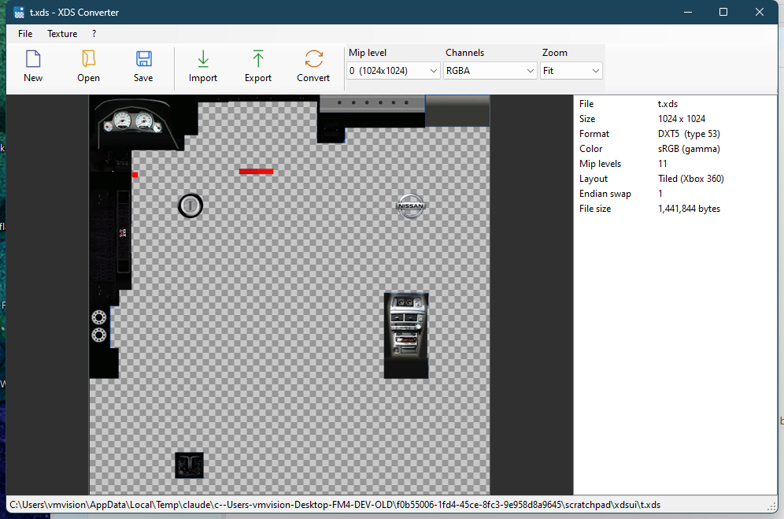

# XDS Converter

Open, import, export and create the **`.xds` textures of Forza Motorsport 4** (Xbox 360).



## Features

- **Open** an `.xds`: preview with transparency checkerboard, mip level selector, channel view (RGBA / RGB / Alpha / R / G / B), zoom, pixel inspector, texture properties
- **Import** PNG, TGA, BMP, JPG or DDS into the open texture. Mipmaps are generated automatically, the header is kept, images of a different size can be scaled to fit
- **Export** the selected mip level to PNG, TGA or BMP. Values are exported exactly as stored (no gamma conversion), so export → import is lossless apart from block compression
- **New** texture from scratch: width, height, pixel format (**DXT1, DXT3, DXT5, DXN, A8R8G8B8**), sRGB/gamma on or off, mipmaps on or off; or *New from image*
- **Convert** the format / size of an existing texture
- Drag & drop `.xds` files or images onto the window. Saving an existing file keeps a `.bak` of the original

## Build

Windows 10/11, nothing to install (uses the .NET Framework that ships with Windows):

```powershell
powershell -ExecutionPolicy Bypass -File build.ps1
```

Produces `XdsConverter.exe`, a single file with `texconv.exe` embedded (it is extracted to `%TEMP%\XdsConverter` on first run). If a `texconv.exe` sits next to the exe, that one is used instead.

## Tests

`SelfTest.cs` needs a folder of real `.xds` files (not included). It checks that:

1. the header and data size generated for a texture of a given size/format/gamma are **identical to the real file** (272 / 272 files matched during development),
2. every mip level of every file decodes,
3. export → import keeps the header and file size and loses almost nothing,
4. new textures in every format and several sizes survive a save / reload cycle.

```powershell
$csc = "$env:WINDIR\Microsoft.NET\Framework\v4.0.30319\csc.exe"
& $csc /nologo /out:selftest.exe /reference:System.Drawing.dll Dxt.cs XenosTiling.cs XdsTexture.cs XdsTexture.Layout.cs XdsTexture.Encode.cs XdsTexture.Create.cs SelfTest.cs
.\selftest.exe .\texconv.exe C:\path\to\empty_work_dir C:\path\to\folder_with_xds_files
```

## XDS format notes

An `.xds` is a 52-byte big-endian `D3DBaseTexture` header followed by Xbox 360 texture memory. The last six header dwords are the Xenos *texture fetch constant*:

| Header dword | Meaning |
|---|---|
| 7 (fetch 0) | bit 31 tiled · bits 22-30 pitch/32 · bits 2-9 sign (`0x3F` = sRGB gamma on RGB) · bits 0-1 = 2 |
| 8 (fetch 1) | bits 0-5 format · bits 6-7 endian swap · bits 12+ base page |
| 9 (fetch 2) | `(width-1) \| (height-1) << 13` |
| 10 (fetch 3) | `0xD10` (block formats) / `0xC14` (A8R8G8B8) |
| 11 (fetch 4) | bits 6-9 = last mip level |
| 12 (fetch 5) | `0x200` 2D · `0x800` packed mips · bits 12+ mip page |

Formats seen in the game files: `53` DXT5 (sRGB), `51` DXT1 (sRGB), `49` DXN, `50` A8R8G8B8 (sRGB, stored linear/untiled), `6` A8R8G8B8. Block data is 8-in-16 byte-swapped (32-bit swapped for A8R8G8B8) and stored in the Xenos tiled layout; levels of textures with a side ≤ 16 texels live in a packed tail inside the base level.

Textures created by this tool use the same header rules (verified byte for byte against the real files). **Not verified in-game**: linear (non-sRGB) DXT1/3/5 and DXT3 — no real files with those headers were available to compare.

## Credits and licenses

- Xbox 360 tiling, mip layout and DXT decoding are derived from **Forza Studio** by Mike Davis (MIT), which in turn follows Xenia's `texture_util`.
- Block compression and mipmap generation are done by **texconv / DirectXTex** from Microsoft (MIT), bundled as `texconv.exe`.
- See [THIRD_PARTY_NOTICES.md](THIRD_PARTY_NOTICES.md). The code of this repository is [MIT](LICENSE).

## Disclaimer

Unofficial fan tool, not affiliated with Microsoft, Turn 10 Studios or Playground Games. No game files are included. Use it only on your own copies of the game data.
